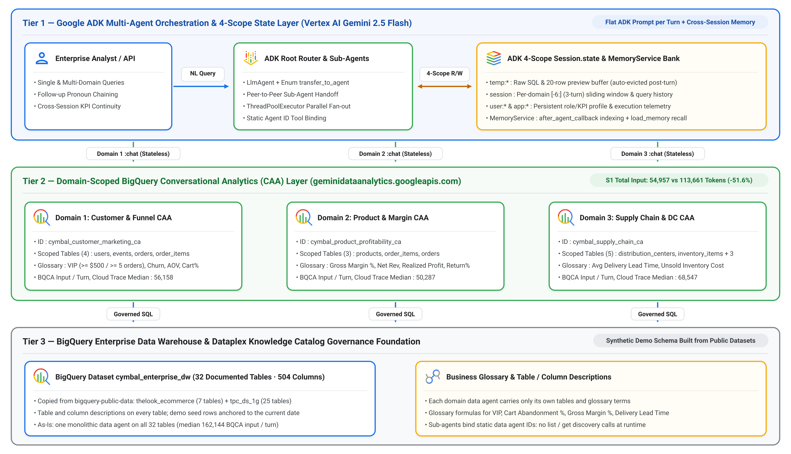

# Governed Multi-Agent Analytics with Google ADK & BigQuery CAA: State, Routing & 2-Tier Token Optimization Blueprint

> **PoC Reference Architecture, Live `As-Is` vs `To-Be` Benchmark Suite & Verification Portals**  
> **GitHub Repository**: [https://github.com/rhkim77/agentic_bi_showcase](https://github.com/rhkim77/agentic_bi_showcase)  
> **Live English Portal (`Cloud Run`)**: [https://cymbal-agentic-bi-showcase-gleccs7jxa-uc.a.run.app](https://cymbal-agentic-bi-showcase-gleccs7jxa-uc.a.run.app)  
> **Live Korean Verification Portal (`한국어 검증 사이트`)**: [https://cymbal-agentic-bi-showcase-gleccs7jxa-uc.a.run.app/ko](https://cymbal-agentic-bi-showcase-gleccs7jxa-uc.a.run.app/ko)



---

## 1. Two Core Enterprise PoC Challenges Addressed

When integrating **Google Agent Development Kit (`google-adk`)** with **BigQuery Conversational Analytics (`BQCA` / `geminidataanalytics.googleapis.com/v1`)** for enterprise NL2SQL platforms, engineering teams consistently hit two architectural walls:

1. **Challenge 1 — `Root Agent <-> Sub-Agent (BQCA)` State, Stateless, Memory & Routing Friction**:
   - ADK's built-in `DataAgentToolset` (`ask_data_agent`) invokes runtime discovery (`_get_data_agent_info`) on every call and sends `[1 UserMessage]` only to BQCA—forcing the upstream ADK agent to replay its growing session history to restate prior context on follow-up questions.
   - Conversely, BQCA's server-managed `ConversationReference` locks **`1 Conversation = 1 Fixed DataAgent`**, blocking cross-domain pivots, serializing multi-domain queries, and lacking `CMEK` support in `global`.
   - Composite root-cause questions spanning multiple business domains either hit one monolithic data agent carrying the entire warehouse schema or require coordinated delegation across domain-scoped data agents.
2. **Challenge 2 — Token use in two tiers (`ADK` and `BQCA`)**:
   - BQCA re-reads the schema and glossary bound to a data agent on each of its internal LLM calls, so one data agent bound to a whole documented warehouse costs about 1.5 to 2 times the BQCA input of a domain-scoped one in the measurements below, depending on how many tables the domain needs.
   - The default ADK agent replays the full session, including each raw `ask_data_agent` response, on every LLM call, so its prompt grows with the number of turns.

---

## 2. `As-Is` vs. `To-Be` Scorecard (Measured 2026-11-27)

Both pipelines ran on Google Cloud through the same engine as the portal's live workbench ([`scripts/04_run_scenario_benchmarks.py`](./scripts/04_run_scenario_benchmarks.py), results in [`benchmarks/scenario_benchmark_results.json`](./benchmarks/scenario_benchmark_results.json)). Nothing in this table is modeled.

- **`As-Is`**: a plain ADK agent using the built-in data agent tools (`ask_data_agent`) on one data agent bound to all 32 tables and the glossary of every domain.
- **`To-Be`**: the Root Router with six domain Sub-Agents, each calling a data agent bound to 3 to 13 tables and its own glossary, and a fallback Sub-Agent that calls the warehouse-wide data agent when one result needs several domains or no domain fits. The domain data agents cover 31 of the 32 tables; the fallback reaches all 32.
- **ADK tokens**: `Vertex AI usage_metadata` prompt tokens of every LLM call in the turn.
- **BQCA tokens**: `gen_ai.usage.*` of the `generate_content` spans that BQCA wrote to Cloud Trace for the chat calls of the turn.
- **Cost**: measured tokens at published rates (BQCA `$3.00` input and `$20.00` output per 1M, with the standard 90% context-cache discount `$0.30` per 1M applied to `cache_read` spans; `gemini-2.5-flash` `$0.30` input, `$0.03` cached input, `$2.50` output per 1M). BigQuery query cost is not included.

| Scenario | ADK prompt As-Is | ADK prompt To-Be | BQCA input As-Is | BQCA input To-Be | Total input As-Is | Total input To-Be | Token delta | Cost As-Is | Cost To-Be | Cost delta | BQCA calls As-Is / To-Be | Latency As-Is / To-Be |
| :--- | ---: | ---: | ---: | ---: | ---: | ---: | ---: | ---: | ---: | ---: | :---: | :---: |
| `S1` online shop question (Customer) | 6,575 | 2,606 | 167,443 | 81,273 | 174,018 | 83,879 | **-51.8%** | $0.5489 | $0.2886 | **-47.4%** | 1 / 1 | 26.3s / 18.1s |
| `S1` retail store channel question | 5,429 | 2,589 | 110,080 | 108,883 | 115,509 | 111,472 | **-3.5%** | $0.3486 | $0.2077 | **-40.4%** | 1 / 1 | 19.5s / 46.0s |
| `S2` follow-up question | 14,267 | 1,863 | 229,120 | 55,977 | 243,387 | 57,840 | **-76.2%** | $0.5281 | $0.2280 | **-56.8%** | 1 / 1 | 30.7s / 21.7s |
| `S3` domain switch (Customer to Supply Chain) | 21,928 | 6,480 | 111,964 | 54,851 | 133,892 | 61,331 | **-54.2%** | $0.3785 | $0.1918 | **-49.3%** | 1 / 1 | 23.2s / 15.0s |
| `S3` separate questions on three online shop domains (fan-out) | 40,739 | 13,168 | 118,278 | 222,280 | 159,017 | 235,448 | **+48.1%** | $0.4583 | $0.7213 | **+57.4%** | 1 / 3 | 88.5s / 30.9s |
| `S3` three retail channels in one result (fallback) | 41,403 | 10,192 | 111,923 | 111,925 | 153,326 | 122,117 | **-20.4%** | $0.3769 | $0.3729 | **-1.1%** | 1 / 1 | 21.8s / 16.4s |
| `S4` turn 8 of the session | 34,500 | 6,365 | 291,352 | 117,471 | 325,852 | 123,836 | **-62.0%** | $0.5788 | $0.3158 | **-45.4%** | 1 / 1 | 36.9s / 18.5s |
| `S5` recall in a new session | 2,238 | 3,191 | 0 | 0 | 2,238 | 3,191 | **+42.6%** | $0.0013 | $0.0050 | **+296.8%** | 0 / 0 | 3.3s / 10.2s |

`S4` over 8 turns with 8 different questions across the online shop and retail channel domains: average total input per turn 175,625 (`As-Is`) vs 81,374 (`To-Be`), **-53.7%**; average cost per turn $0.3545 vs $0.2285, **-35.6%**. The `To-Be` ADK prompt stayed between 1,772 and 6,718 tokens per turn; the `As-Is` ADK prompt went from 5,604 to a maximum of 34,500.

BQCA input per chat turn by data agent, as the median of uncached turns in Cloud Trace ([`benchmarks/bqca_trace_token_calibration.json`](./benchmarks/bqca_trace_token_calibration.json), 344 chat turns since 2026-11-27T01:57:30Z):

| Data agent | Domain | Tables | Uncached turns sampled | Median BQCA input per turn | vs warehouse-wide |
| :--- | :--- | ---: | ---: | ---: | ---: |
| `cymbal_customer_marketing_ca` | Customer & Marketing (online shop) | 4 | 41 | 54,907 | -50.9% |
| `cymbal_product_profitability_ca` | Product & Profitability (online shop) | 3 | 12 | 50,461 | -54.9% |
| `cymbal_supply_chain_ca` | Supply Chain (online shop) | 5 | 23 | 55,180 | -50.7% |
| `cymbal_store_channel_ca` | Store Channel (retail) | 13 | 6 | 74,575 | -33.4% |
| `cymbal_catalog_channel_ca` | Catalog Channel (retail) | 11 | 7 | 74,345 | -33.6% |
| `cymbal_web_channel_ca` | Web Channel (retail) | 11 | 2 | 114,012 | +1.9% |
| `cymbal_enterprise_monolithic_ca` | Warehouse-wide (As-Is, and To-Be fallback) | 32 | 94 | 111,931 | baseline |

How to read it:

- **The saving depends on how large a domain has to be**: about 33% to 55% less BQCA input per turn on 5 of 6 domains, none on Web Channel. The `cymbal_web_channel_ca` data agent stayed level with the warehouse-wide data agent: all 11 sampled turns were at 111,294 tokens or more (median `114,012`), although its bound schema and instruction are about the same size as the Catalog data agent's. The cause is not identified. Tables that are joined in one query must sit in the same data agent. The online shop domains need 3 to 5 tables. The retail channels are a star schema, so each sales fact brings its shared dimension tables and the data agents hold 11 to 13 tables.
- **Token delta and cost delta**: some BQCA turns report an additional, mostly cache-read pass. Such a turn has more input tokens and a lower cost. A single row can pair such a turn on one side with a plain turn on the other, so the token delta of one row can be larger or smaller than the like-for-like difference. The cost column and the per-data-agent medians are the steadier figures.
- **Where there is no gain**: a result that combines the three retail channels needs tables of three domains in one query, so the `To-Be` router sends it to the warehouse-wide data agent (`To-Be` called ['cymbal_enterprise_monolithic_ca'] in this run). For separate questions on three online shop domains `To-Be` makes one BQCA call per domain, so that row depends on how many calls `As-Is` makes: `As-Is` made 1 call(s) and `To-Be` 3 in this run; in an earlier run `As-Is` answered with one call and `To-Be` used more input tokens.
- **Routing is an LLM decision**: over the 8 turns of `S4` there were 8 BQCA calls for `To-Be` and 8 for `As-Is`. A router can send a single-domain question to more than one data agent, which costs an extra call.
- **`S5`**: neither side calls BQCA. `To-Be` answers from user-scoped state and memory through `inspect_session_and_memory_status`; `As-Is` replies that it has no memory of earlier sessions. The profile shown in the baseline answer is the default profile in `agent.py`, because that run saved no profile; the findings it lists come from the earlier sessions of the run.
- **Answer check**: seven preset questions have a hand-written reference query ([`backend/reference_answers.py`](./backend/reference_answers.py)); the portal shows its rows next to both answers. [`scripts/07_answer_check.py`](./scripts/07_answer_check.py) ran each question 5 times on 2026-11-27 and counted the runs in which every reference figure appeared in the result table or answer of each side ([`benchmarks/answer_check_results.json`](./benchmarks/answer_check_results.json)):

| Question | To-Be: runs with every reference figure | As-Is: runs with every reference figure |
| :--- | :---: | :---: |
| `S1` online shop question | 5 of 5 | 3 of 5 |
| `S2` follow-up question | 0 of 5 | 0 of 5 |
| `S3` domain switch | 5 of 5 | 5 of 5 |
| `S3` three online shop domains | 0 of 5 | 1 of 5 |
| `S3` three retail channels in one result | 5 of 5 | 5 of 5 |
| `S4` preset question | 5 of 5 | 5 of 5 |
| `S1` retail store channel question | 5 of 5 | 5 of 5 |

  On the `S2` follow-up both designs usually computed revenue and AOV over all customers where the reference reads them as VIP-only, so that row is a difference in reading. This is a spot check with a small sample, not an accuracy evaluation, and the same question can give different answers on different runs.
- **Limits**: three runs per scenario on one day; the tables show one of them, picked afterwards because it had no multi-minute wait on a Gemini call, and token deltas of single rows moved by 20 to 30 points between the runs ([`benchmarks/repeat_runs.json`](benchmarks/repeat_runs.json)). The warehouse is a synthetic reproduction of an enterprise schema: 32 tables (thelook 7 and TPC-DS 25) with rule-generated table and column descriptions. On the original 7-table schema without descriptions the BQCA input of both designs was about the same.

---

## 3. Repository Structure & Quickstart

- **[`agents/bq_caa_3domain_multi_agent/agent.py`](./agents/bq_caa_3domain_multi_agent/agent.py)**: Reference implementation with Root Router + 6 domain-scoped Sub-Agents and a warehouse-wide fallback Sub-Agent, static instructions, `before_model_callback` 3-turn compaction, `after_model_callback` `usage_metadata` telemetry, `[-6:]` sliding window, `ThreadPoolExecutor` parallel fan-out, and per-visitor isolated 4-Scope `Session.state` + `MemoryService`.
- **[`backend/main.py`](./backend/main.py)**, **[`backend/workbench_engine.py`](./backend/workbench_engine.py)** & **[`backend/reference_answers.py`](./backend/reference_answers.py)**: FastAPI + real-time `SSE` (`POST /api/workbench/stream`) engine powering the **Interactive S1–S5 Progressive Dual A/B Workbench**, live ADK step-stream flow visualization, and BigQuery reference SQL execution alongside both pipelines.
- **[`agents/bq_caa_streaming_agent/agent.py`](./agents/bq_caa_streaming_agent/agent.py)** & **[`agents/bq_caa_toolset_agent/agent.py`](./agents/bq_caa_toolset_agent/agent.py)**: Companion `SequentialAgent` custom `:chat` streamer and built-in `DataAgentToolset` baseline packages.
- **[`docs/ARCHITECTURE_AND_CONFIGURATION_GUIDE.md`](./docs/ARCHITECTURE_AND_CONFIGURATION_GUIDE.md)** & **[`docs/SCENARIO_WALKTHROUGH_AND_BENCHMARKS.md`](./docs/SCENARIO_WALKTHROUGH_AND_BENCHMARKS.md)**: Full architectural specification and A/B SQL/telemetry walkthrough.
- **[`docs/index.html`](./docs/index.html)** (`EN`) & **[`docs/index_ko.html`](./docs/index_ko.html)** (`KO`): Portals with the measured baseline, the live Dual A/B workbench and a cost calculator.
- **[`click-to-deploy/`](./click-to-deploy/)**: Terraform IaC (`main.tf`, `variables.tf`, `outputs.tf`, `README.md`) for Cloud Run, BigQuery dataset, Artifact Registry, and least-privilege IAM.

```bash
gcloud auth application-default login --scopes="https://www.googleapis.com/auth/cloud-platform"
export GOOGLE_GENAI_USE_VERTEXAI=TRUE
export GOOGLE_CLOUD_PROJECT="your-gcp-project-id"

git clone https://github.com/rhkim77/agentic_bi_showcase.git
cd agentic_bi_showcase
uv sync
uv run python scripts/provision_enterprise_warehouse.py   # 32-table warehouse + monolithic As-Is data agent
uv run python scripts/refresh_demo_seed.py
uv run python scripts/provision_cymbal_caa_agents.py       # 6 domain-scoped To-Be data agents
uv run python scripts/04_run_scenario_benchmarks.py        # measured S1-S5 baseline
uv run python scripts/05_measure_bqca_tokens_from_trace.py # Cloud Trace medians used by the live workbench
uv run python scripts/06_build_reference_answers.py        # reference query snapshot for the preset questions (shown next to both answers)
uv run python scripts/build_outcome_portal.py
# optional, against a running service: python3 scripts/07_answer_check.py --base-url http://127.0.0.1:8080
```

---

## 4. Official Public References

1. **Google Cloud — Integration Patterns for Data Agents**: [Integration patterns for data agents](https://cloud.google.com/gemini/docs/conversational-analytics-api/integration-patterns)
2. **Google Cloud — State Management for Data Agents**: [State management for data agents](https://cloud.google.com/gemini/docs/conversational-analytics-api/state-management)
3. **Google Cloud — Data Cloud Agents & Vertex AI Pricing**: [Data Cloud Agents pricing](https://cloud.google.com/products/data-agents/pricing) · [Vertex AI pricing](https://cloud.google.com/vertex-ai/generative-ai/pricing)
4. **Google ADK — Multi-Agent Systems**: [Multi-Agent Systems in ADK](https://google.github.io/adk-docs/agents/multi-agents/)
5. **Google ADK — 4-Scope Sessions, State & Memory**: [Session, State, and Memory in ADK](https://google.github.io/adk-docs/sessions/)
