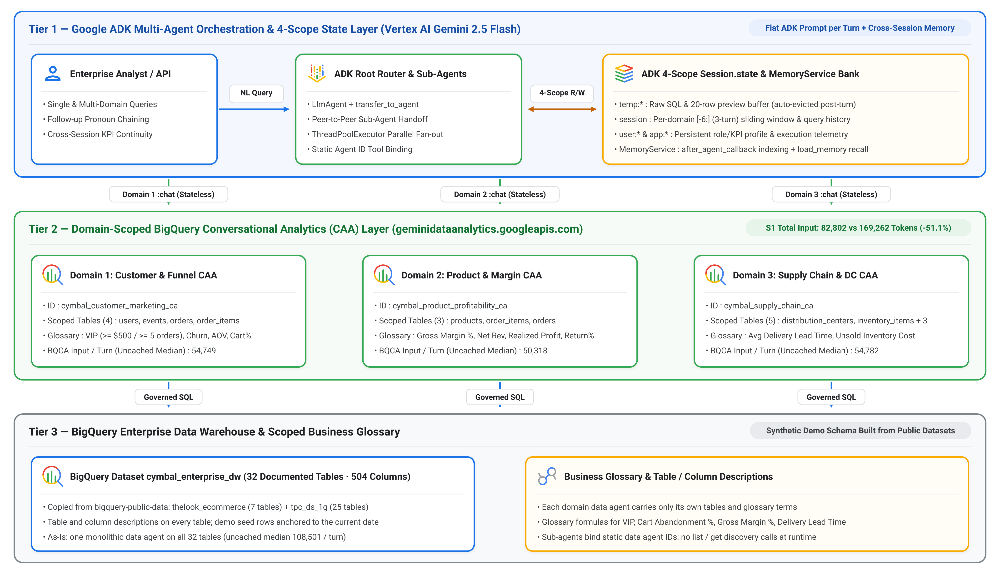
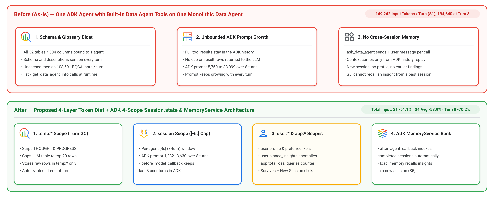

# Architecture & Configuration Deep Dive: Multi-Agent Analytics with Google ADK & BigQuery CAA

## 1. Official Integration Taxonomy & Architectural Trade-Offs

Google Cloud's official documentation ([Integration patterns for data agents](https://cloud.google.com/gemini/docs/conversational-analytics-api/integration-patterns), [State management for data agents](https://cloud.google.com/gemini/docs/conversational-analytics-api/state-management)) defines **four integration approaches** (`Direct API`, `ADK`, `MCP`, `A2A`) and **three API context modes** (`ConversationReference`, `DataAgentContext`, `InlineContext`) for the Conversational Analytics API (`geminidataanalytics.googleapis.com/v1`).

When scaling Text-to-SQL from small PoCs to documented enterprise warehouses with dozens of tables and domain-specific KPI definitions, teams run into three structural constraints:

1. **BQCA Schema & Glossary Footprint**: BQCA typically makes two internal LLM calls per `:chat` turn, and each call reads the schema, column descriptions, and glossary bound to the data agent. On the 32-table documented warehouse in this repository (`cymbal_enterprise_dw`, 504 columns), one monolithic data agent uses roughly twice the BQCA input tokens per turn of a domain-scoped data agent (`108,438` vs `50,322–54,770` uncached Cloud Trace medians).
2. **ADK Session Replay Growth**: ADK's built-in `ask_data_agent` tool looks up the data agent on every call and sends `[UserMessage(text=query)]` (1 message) to BQCA. Multi-turn context therefore relies on the upstream ADK agent replaying its growing conversation history, including full tool responses (`5,760` → `33,099` ADK prompt tokens across 8 turns in `S4`).
3. **Single-Agent Conversation Lock-In**: BQCA's server-managed stateful `ConversationReference` keeps history on the server within a single data agent, but binds `1 Conversation = 1 Fixed DataAgent`, preventing domain switches within one conversation and lacking `CMEK` support in `global`.

### Multi-Perspective Architecture Decision Matrix

| Evaluation Dimension | 1. Built-in ADK `DataAgentToolset` on Monolithic CAA (`As-Is`) | 2. Managed Stateful API (`ConversationReference`) | 3. Proposed Hybrid: ADK 4-Scope State + 3 Domain-Scoped Stateless CAAs (`To-Be`) |
| :--- | :--- | :--- | :--- |
| **API Context Mode & IAM** | `DataAgentContext` (`roles/geminidataanalytics.dataAgentUser`) | `ConversationReference` (`roles/geminidataanalytics.dataAgentUser`) | `DataAgentContext` (`roles/geminidataanalytics.dataAgentUser`) |
| **BQCA Input / Turn** | All 32 tables + all glossaries (`108,438` uncached median) | Same as the bound data agent (`90%` cached input discount within one conversation) | **3–5 tables + single domain glossary (`50,322–54,770` uncached median)** |
| **ADK Prompt / Turn** | Replays full session + raw tool payloads (`5,760` → `33,099` over 8 turns) | Depends on wrapper client | **Static instructions + 3-turn window + slim tool view (`1,282–3,630` over 8 turns)** |
| **Multi-Domain Routing** | Single monolithic data agent (1 or multiple calls depending on LLM choice) | Locked to 1 fixed data agent per conversation | **Root delegation, direct peer `transfer_to_agent`, or parallel `ThreadPoolExecutor` fan-out** |
| **Cross-Session Continuity** | None | Bound to single conversation ID (180-day idle TTL) | **`user:*` state + `ADK MemoryService` recall with `0` BQCA calls (`S5`)** |
| **Best-Fit Workload** | Small schemas (`<= 7` tables) or one-off exploratory queries | Single-department BI chatbot without custom state storage | **Multi-domain enterprise warehouses requiring cross-domain pivots and cross-session memory** |

---

## 2. Warehouse Setup & Domain-Scoped Data Agents

[`scripts/provision_enterprise_warehouse.py`](../scripts/provision_enterprise_warehouse.py) builds `cymbal_enterprise_dw` (32 tables, 504 columns with rule-generated table and column descriptions: 7 `thelook_ecommerce` tables plus 25 `tpc_ds_1g` retail tables) and provisions the monolithic `As-Is` data agent (`cymbal_enterprise_monolithic_ca`). [`scripts/provision_cymbal_caa_agents.py`](../scripts/provision_cymbal_caa_agents.py) provisions three domain-scoped `To-Be` data agents:

| Domain | ADK Sub-Agent (`agents/bq_caa_3domain_multi_agent`) | BigQuery CAA Resource ID | Scoped Tables | Scoped Business Glossary Formulas |
| :--- | :--- | :--- | :--- | :--- |
| **Domain 1: Customer & Marketing** | `customer_marketing_subagent` | `cymbal_customer_marketing_ca` | `users`, `events`, `orders`, `order_items` (4 tables) | • **VIP Customer**: `SUM(sale_price) >= 500 OR COUNT(DISTINCT order_id) >= 5` • **Dormant Customer**: Zero orders in last 90 days • **Cart Abandonment Rate (%)**: Cart sessions without `purchase` / total `cart` sessions • **AOV**: `SUM(sale_price) / COUNT(DISTINCT order_id)` |
| **Domain 2: Product & Profitability** | `product_profitability_subagent` | `cymbal_product_profitability_ca` | `products`, `order_items`, `orders` (3 tables) | • **Product Gross Margin %**: `SAFE_DIVIDE(retail_price - cost, retail_price) * 100` • **Realized Gross Profit**: `SUM(sale_price - cost)` where `status NOT IN ('Returned', 'Cancelled')` • **Return & Cancel Rate (%)**: `COUNTIF(status IN ('Returned','Cancelled')) * 100 / COUNT(*)` |
| **Domain 3: Supply Chain & Fulfillment** | `supply_chain_logistics_subagent` | `cymbal_supply_chain_ca` | `distribution_centers`, `inventory_items`, `order_items`, `orders`, `products` (5 tables) | • **Distribution Center (DC)**: `order_items.product_id = products.id` → `products.distribution_center_id = distribution_centers.id` • **Average Delivery Lead Time**: `AVG(TIMESTAMP_DIFF(delivered_at, shipped_at, DAY))` • **Unsold Inventory Holding Cost ($)**: `SUM(cost)` where `sold_at IS NULL` • **Merchandising Hierarchy**: Exact department/category values (`Women` / `Outerwear & Coats`) |

### Key Implementation Guardrails

1. **`cloud-platform` OAuth Scope Injection**: ADK's built-in `DataAgentCredentialsConfig` defaults to `["https://www.googleapis.com/auth/bigquery"]`, which `geminidataanalytics.googleapis.com` rejects with `HTTP 403 ACCESS_TOKEN_SCOPE_INSUFFICIENT`. All packages in [`agents/`](../agents/) inject `google.auth.default(scopes=["https://www.googleapis.com/auth/cloud-platform"])`.
2. **Static Agent Binding & `skip_summarization`**: Each `Sub-Agent` binds one domain tool with a static data agent ID (eliminating runtime `list_accessible_data_agents` / `get_data_agent_info` calls) and sets `tool_context.actions.skip_summarization = True` after a successful single-domain call so BQCA's answer is returned without a second ADK summarization hop.
3. **Relative-Timestamp Demo Seeding**: [`sql/seed_cymbal_scenarios.sql`](../sql/seed_cymbal_scenarios.sql) and [`scripts/refresh_demo_seed.py`](../scripts/refresh_demo_seed.py) anchor seeded records (`id >= 9900000`) to `CURRENT_TIMESTAMP()`, establishing 60 VIP customers, a `50.0%` return/cancellation rate on `Nordic Luxe` (`$7,200` realized profit vs `$11,520` for `TheLook Atelier` at `20.0%`), and a `6.0-day` delivery lead time at `Memphis TN (DC #1)` vs `2.0 days` at `Chicago IL (DC #2)`.

---

## 3. Root-to-SubAgent 3-Way Routing Mechanics (`Path A`, `Path B`, `Path C`)

- **Path A — Single-Domain Delegation (`transfer_to_agent`)**: `cymbal_enterprise_root_router` delegates single-domain questions to `customer_marketing_subagent`, `product_profitability_subagent`, or `supply_chain_logistics_subagent` within the same turn.
- **Path B — Direct Peer-to-Peer Domain Switch**: When a domain `Sub-Agent` is active and the next turn asks about another domain, the active `Sub-Agent` calls `transfer_to_agent` directly to its peer without bouncing back through `root_agent`.
- **Path C — Concurrent Multi-Domain Fan-Out (`run_cross_domain_caa_analysis`)**: For questions spanning 2–3 domains, `root_agent` decomposes the prompt into domain-specific sub-questions (preserving all user filters), snapshots `domain_ca_multiturn_messages[-6:]`, and dispatches stateless `:chat` calls concurrently via `ThreadPoolExecutor`. Note that `Path C` always makes one BQCA call per domain (`2–3` calls total), so its token comparison against `As-Is` depends on whether `As-Is` answers in one monolithic call or multiple calls.

---

## 4. 4-Scope `Session.state`, `MemoryService` & 2-Tier Token Diet

| ADK State / Memory Layer | Key Names in `agent.py` | Architectural Purpose |
| :--- | :--- | :--- |
| **1. `temp:*` (Turn Scope)** | `temp:last_caa_sql`, `temp:last_caa_rows`, `temp:last_caa_row_count` | Holds raw rows (`<= 20`) during the turn and evicts automatically after the turn, while `_llm_view()` returns only the prose answer and a capped Markdown table to the LLM. |
| **2. `session` (Sliding Windows)** | `before_model_callback` (`MAX_ADK_UPSTREAM_USER_TURNS=3`), `domain_ca_multiturn_messages[agent_id][-6:]` | Keeps at most the last 3 user turns in `llm_request.contents` (`1,282–3,630` ADK prompt tokens across 8 turns in `S4`) and sends up to 6 compact prior messages (`3` turns, `THOUGHT`/`PROGRESS` stripped) per domain to stateless `:chat`. |
| **3. `user:*` & `app:*` (Persistent Scopes)** | `user:profile`, `user:preferred_kpis`, `user:pinned_insights`, `app:total_caa_queries_executed` | Persists analyst role, KPI preferences, and pinned anomalies across sessions (isolated per visitor via `VISITOR_ID_VAR`), read on demand through root tools so agent system instructions remain static. |
| **4. `ADK MemoryService` (Long-Term Recall)** | `before_agent_callback`, `after_agent_callback` (`add_session_to_memory`), `load_memory` | Indexes completed sessions into `MemoryService` so a new session can recall prior findings with `0` BQCA calls (`S5`). |

---

## 5. Repository Package Comparison (`agents/`)

1. **[`agents/bq_caa_toolset_agent/`](../agents/bq_caa_toolset_agent/agent.py)** (*Pattern A — Built-in Toolset Baseline*): Single-agent wrapper around `data_agent_tool.ask_data_agent` comparing `cymbal_enterprise_monolithic_ca` against `cymbal_customer_marketing_ca` on `cymbal_enterprise_dw`.
2. **[`agents/bq_caa_streaming_agent/`](../agents/bq_caa_streaming_agent/agent.py)** (*Pattern B — Sequential Custom `BaseAgent` Streamer*): Implements `SequentialAgent` (`ConversationalAnalyticsStreamingAgent` → `executive_insight_synthesizer`) passing BigQuery results via `temp:data_result`.
3. **[`agents/bq_caa_3domain_multi_agent/`](../agents/bq_caa_3domain_multi_agent/agent.py)** (*Pattern C — Multi-Domain Reference*): Root Router + 3 Domain-Scoped Sub-Agents + `[-6:]` Sliding Window + Parallel Fan-out + 4-Scope `Session.state` & `MemoryService`.

---

## 6. Official Public References

1. **Google Cloud — Integration Patterns for Data Agents**: [Integration patterns for data agents](https://cloud.google.com/gemini/docs/conversational-analytics-api/integration-patterns)
2. **Google Cloud — State Management for Data Agents**: [State management for data agents](https://cloud.google.com/gemini/docs/conversational-analytics-api/state-management)
3. **Google Cloud — Data Cloud Agents Pricing**: [Data Cloud Agents pricing](https://cloud.google.com/products/data-agents/pricing)
4. **Google Agent Development Kit (ADK) — Multi-Agent Systems**: [Multi-Agent Systems in ADK](https://google.github.io/adk-docs/agents/multi-agents/)
5. **Google Agent Development Kit (ADK) — Sessions, State & Memory**: [Session, State, and Memory in ADK](https://google.github.io/adk-docs/sessions/)
