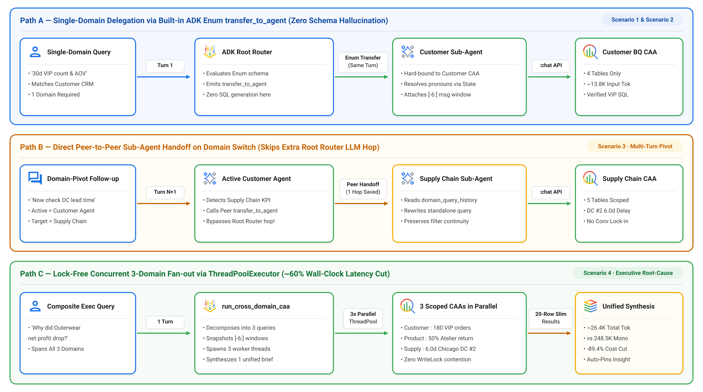

# Architecture & Configuration Deep Dive: Governed Multi-Agent Analytics with Google ADK & BigQuery CAA

## 1. Official Integration Taxonomy & Architectural Rationale

Google Cloud's official documentation ([Integration patterns for data agents](https://cloud.google.com/gemini/docs/conversational-analytics-api/integration-patterns), [State management for data agents](https://cloud.google.com/gemini/docs/conversational-analytics-api/state-management)) defines **four integration approaches** (`Direct API`, `ADK`, `MCP`, `A2A` across seven implementation patterns) and **three API context modes** (`ConversationReference`, `DataAgentContext`, `InlineContext`) for the Conversational Analytics API (`geminidataanalytics.googleapis.com/v1`).

When scaling Text-to-SQL from single-table PoCs into production enterprise data warehouses containing dozens or hundreds of tables and department-specific KPI rules, architects face three structural bottlenecks:

1. **Prompt Token Inflation (`110,764+` Input Tokens per Turn)**: Binding an entire enterprise warehouse schema, column descriptions, and business glossary rules into a single monolithic `Data Agent` injects massive DDL metadata into every LLM turn—driving per-query costs near `$0.47` (`~$1.7M/year` at 10,000 daily queries).
2. **Cross-Domain Schema Collisions & Cartesian Fan-Out**: Co-locating `users.created_at` (signup date), `orders.created_at` (order date), and `inventory_items.created_at` (inbound stock date) inside one unscoped prompt causes ambiguous timestamp joins and N:M Cartesian SQL inflation across fact tables (`events` vs. `order_items` vs. `inventory_items`).
3. **Multi-Turn Amnesia vs. Single-Agent Lock-In**:
   - Calling ADK's built-in `DataAgentToolset` (`ask_data_agent`) out of the box sends `[UserMessage(text=query)]` (1 message only) per turn, losing prior filter conditions on follow-up questions.
   - Conversely, managed stateful `ConversationReference` binds **`1 Conversation = 1 Fixed DataAgent`**. The moment an executive pivots from Marketing to Supply Chain—or asks a composite cross-domain question—server-side conversation state cannot be shared across domain agents, and `global` location resources do not support customer-managed encryption keys (CMEK).

### Multi-Perspective Architecture Decision Matrix

| Evaluation Dimension | 1. Unscoped Monolithic Single CAA | 2. Default ADK `DataAgentToolset` (One-Shot) | 3. Managed Stateful API (`ConversationReference`) | 4. Proposed Architecture: ADK 4-Scope State + 3 Scoped Stateless CAAs |
| :--- | :--- | :--- | :--- | :--- |
| **API Context Mode & IAM** | `DataAgentContext` (`dataAgentUser`) | `DataAgentContext` (`dataAgentUser`) | `ConversationReference` (`dataAgentUser`) | `DataAgentContext` (`roles/geminidataanalytics.dataAgentUser`) |
| **Input Tokens / Turn** | `110,764+ tok` (Full DW DDL every turn) | `110,764+ tok` (or unscoped discovery calls) | Grows linearly up to server context cap (`90%` cached discount within 1 agent) | **`13,800–26,400 tok` (`-85% to -92%` bounded by `[-6:]` window)** |
| **SQL Join Determinism** | Low on multi-fact schemas (`created_at` collisions) | Medium (single-turn only) | High within 1 domain; fails across domains | **High (isolated `4 / 3 / 5` table scopes + Hop-1 Glossary formulas)** |
| **Multi-Domain Routing & Parallelism** | Single mega-SQL risks N:M Cartesian fan-out | Sequential LLM tool calls | Serialized per conversation; **loses context on domain switch** | **Lock-free `ThreadPoolExecutor` parallel `:chat` fan-out (`~60%` faster)** |
| **Cross-Session Continuity** | None | None | Bound to single conversation ID (180-day idle TTL) | **`user:*` State + `ADK MemoryService` survive `+ New Session`** |
| **Best-Fit Workload** | Small single-mart (`<= 5` tables) | Stateless dashboard summary cards & batch jobs | Single-department standalone BI chat without custom DB | **Enterprise Multi-Domain BI, Executive Root-Cause & Platform Integration** |

---

## 2. Domain-Scoped Configuration & Hop-1 Business Glossary Design

Rather than exposing all 7 warehouse tables to a single agent, [`scripts/provision_cymbal_caa_agents.py`](../scripts/provision_cymbal_caa_agents.py) partitions `thelook_ecommerce_agent` into **three least-privilege Domain Data Agents**, pairing each with domain-specific **Hop-1 Business Glossary** SQL formulas:

| Domain | ADK Sub-Agent (`agents/bq_caa_3domain_multi_agent`) | BigQuery CAA Resource ID | Scoped Tables | Governed Hop-1 Business Glossary Formulas |
| :--- | :--- | :--- | :--- | :--- |
| **Domain 1: Customer & Marketing** | `customer_marketing_subagent` | `cymbal_customer_marketing_ca` | `users`, `events`, `orders`, `order_items` (4 tables) | • **VIP Customer**: `SUM(sale_price) >= 500 OR COUNT(DISTINCT order_id) >= 5` • **Dormant Customer**: Zero orders in last 90 days • **Cart Abandonment Rate (%)**: Cart sessions without `purchase` / total `cart` sessions • **AOV & ARPU**: `SUM(sale_price) / COUNT(DISTINCT order_id)` |
| **Domain 2: Product & Profitability** | `product_profitability_subagent` | `cymbal_product_profitability_ca` | `products`, `order_items`, `orders` (3 tables) | • **Product Gross Margin %**: `SAFE_DIVIDE(retail_price - cost, retail_price) * 100` • **Net Revenue**: Excludes `status IN ('Returned', 'Cancelled')` • **Realized Gross Profit**: `SUM(sale_price - cost)` on non-returned items • **Return & Cancel Rate (%)**: `COUNTIF(status IN ('Returned','Cancelled')) * 100 / COUNT(*)` |
| **Domain 3: Supply Chain & Fulfillment** | `supply_chain_logistics_subagent` | `cymbal_supply_chain_ca` | `distribution_centers`, `inventory_items`, `order_items`, `orders`, `products` (5 tables) | • **Distribution Center (DC)**: `distribution_centers.id = products.distribution_center_id` • **Average Delivery Lead Time**: `AVG(TIMESTAMP_DIFF(delivered_at, shipped_at, DAY))` • **Unsold Inventory Rate & Holding Cost ($)**: `sold_at IS NULL` count % & `SUM(cost)` |

### Key Configuration Guardrails Implemented in This Repository

1. **Keyless `cloud-platform` OAuth Scope Injection**: ADK's built-in `DataAgentCredentialsConfig` defaults to `["https://www.googleapis.com/auth/bigquery"]`, which `geminidataanalytics.googleapis.com` rejects with `HTTP 403 ACCESS_TOKEN_SCOPE_INSUFFICIENT`. All three agent packages in [`agents/`](../agents/) inject `google.auth.default(scopes=["https://www.googleapis.com/auth/cloud-platform"])` with `.with_quota_project(PROJECT_ID)`.
2. **Elimination of Runtime Discovery Overhead**: Sub-agents bind directly to static `cymbal_*_ca` resource IDs and omit `list_accessible_data_agents` / `get_data_agent_info` from runtime tool lists, saving `4,000–8,000` metadata tokens on every turn.
3. **Relative-Timestamp Golden Data Seeding**: [`sql/seed_cymbal_scenarios.sql`](../sql/seed_cymbal_scenarios.sql) and [`scripts/refresh_demo_seed.py`](../scripts/refresh_demo_seed.py) anchor deterministic VIP cohorts, a `50.0%` return & cancellation spike on `Nordic Luxe` wool/cashmere outerwear (`$7,200` realized profit vs. `$11,520` for `TheLook Atelier` at `20.0%`), and a `6.0-day` fulfillment bottleneck at `Memphis TN (DC #1)` (vs. `2.0 days` at `Chicago IL (DC #2)`) relative to `CURRENT_TIMESTAMP()`, guaranteeing reproducible results on any date.

---

## 3. Root-to-SubAgent 3-Way Routing Mechanics (`Path A`, `Path B`, `Path C`)

[`agents/bq_caa_3domain_multi_agent/agent.py`](../agents/bq_caa_3domain_multi_agent/agent.py) orchestrates incoming queries across three distinct execution paths depending on query topology:

- **Path A — Single-Domain Enum Delegation (`transfer_to_agent`)**: `cymbal_enterprise_root_router` declares `sub_agents=[customer_marketing_subagent, product_profitability_subagent, supply_chain_logistics_subagent]`. ADK's `TransferToAgentTool` enforces a strict JSON Schema `enum` over sub-agent names (eliminating agent-name hallucination) and executes the target sub-agent within the **same invocation turn**.
- **Path B — Direct Peer-to-Peer Domain Switch**: When `customer_marketing_subagent` is active and the user pivots to distribution center lead times, ADK's peer transfer graph allows `customer_marketing_subagent` to transfer directly to `supply_chain_logistics_subagent` without bouncing back through `root_agent`—saving an extra LLM round-trip while reading `Session.state["domain_query_history"]` to resolve cross-domain context.
- **Path C — Concurrent Multi-Domain Fan-Out (`run_cross_domain_caa_analysis`)**: For executive root-cause questions spanning 2–3 domains simultaneously, `root_agent` decomposes the prompt into domain-specific sub-questions, snapshots `domain_ca_multiturn_messages[-6:]` on the main thread, and dispatches stateless `:chat` calls concurrently via `ThreadPoolExecutor(max_workers=3)`—cutting wall-clock latency by roughly `55%–62%` with zero server-side `WriteLock` contention.

---

## 4. 4-Scope `Session.state`, `MemoryService` & 4-Layer Token Diet

| ADK State / Memory Layer | Key Names in `agent.py` | Architectural Purpose & Token Diet Impact |
| :--- | :--- | :--- |
| **1. `temp:*` (Turn Scope)** | `temp:last_caa_sql`, `temp:last_caa_rows`, `temp:last_caa_row_count` | Buffers structured rows for intra-turn inspection and **evicts automatically at turn completion**, preventing raw JSON tables from bloating the persistent session log. |
| **2. `session` (Dual O(1) Sliding Windows)** | `before_model_callback` (`MAX_ADK_UPSTREAM_USER_TURNS=3`), `domain_ca_multiturn_messages[agent_id][-6:]`, `compact_routing_digest[-3:]` | Bounds **both** upstream ADK `llm_request.contents` (`3,807` prompt tok vs `51,376` unbounded at Turn 5, `-92.6%`) **and** downstream `:chat` history (`6` compact messages max, `THOUGHT`/`PROGRESS` stripped, 20-row cap) while isolating per-agent caches via `App(context_cache_config=ContextCacheConfig(...))`. |
| **3. `user:*` & `app:*` (Persistent Scopes)** | `user:profile`, `user:preferred_kpis`, `user:pinned_insights`, `app:total_caa_queries_executed` | Injects role/department focus via `{user:profile?}` template placeholders and persists high-priority anomalies across `+ New Session` boundaries. |
| **4. `ADK MemoryService` (Long-Term Bank)** | `before_agent_callback`, `after_agent_callback` (`add_session_to_memory`), `preload_memory`, `load_memory` | Indexes completed analytical sessions into `MemoryService` (backed by disk JSON persistence) so brand-new sessions recall prior root-cause conclusions on Turn 1 with **zero redundant BigQuery scans**. |

---

## 5. Repository Package Comparison (`agents/`)

To allow side-by-side architectural inspection in `adk web agents/`, this repository includes three runnable ADK agent packages:

1. **[`agents/bq_caa_toolset_agent/`](../agents/bq_caa_toolset_agent/agent.py)** (*Pattern A — Built-in Toolset Baseline*): Minimal single-agent wrapper around `data_agent_tool.ask_data_agent` for comparing unscoped `thelook_baseline_ca_agent` against governed `cymbal_customer_marketing_ca`.
2. **[`agents/bq_caa_streaming_agent/`](../agents/bq_caa_streaming_agent/agent.py)** (*Pattern B — Sequential Custom `BaseAgent` Streamer*): Implements `SequentialAgent` (`ConversationalAnalyticsStreamingAgent` → `executive_insight_synthesizer`) passing BigQuery results through `temp:data_result` with zero duplicate SQL execution.
3. **[`agents/bq_caa_3domain_multi_agent/`](../agents/bq_caa_3domain_multi_agent/agent.py)** (*Pattern C — Production Enterprise Reference*): Full Root Router + 3 Domain-Scoped Sub-Agents + `[-6:]` Sliding Window + Parallel Fan-out + 4-Scope `Session` & `MemoryService`.

---

## 6. Official Public References

1. **Google Cloud — Integration Patterns for Data Agents**: [Integration patterns for data agents](https://cloud.google.com/gemini/docs/conversational-analytics-api/integration-patterns)
2. **Google Cloud — State Management for Data Agents**: [State management for data agents](https://cloud.google.com/gemini/docs/conversational-analytics-api/state-management)
3. **Google Cloud — Conversational Analytics API Overview**: [Conversational Analytics API overview](https://cloud.google.com/gemini/docs/conversational-analytics-api/overview)
4. **Google Agent Development Kit (ADK) — Multi-Agent Systems**: [Multi-Agent Systems in ADK](https://google.github.io/adk-docs/agents/multi-agents/)
5. **Google Agent Development Kit (ADK) — Sessions, State & Memory**: [Session, State, and Memory in ADK](https://google.github.io/adk-docs/sessions/)
