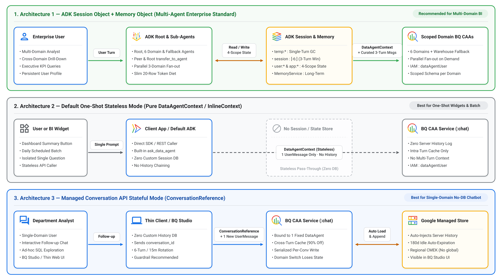

# Architecture & Configuration Deep Dive: Multi-Agent Analytics with Google ADK & BigQuery CAA

## 1. Official Integration Taxonomy & Architectural Trade-Offs

Google Cloud's official documentation ([Integration patterns for data agents](https://cloud.google.com/gemini/docs/conversational-analytics-api/integration-patterns), [State management for data agents](https://cloud.google.com/gemini/docs/conversational-analytics-api/state-management)) defines **four integration approaches** (`Direct API`, `ADK`, `MCP`, `A2A`) and **three API context modes** (`ConversationReference`, `DataAgentContext`, `InlineContext`) for the Conversational Analytics API (`geminidataanalytics.googleapis.com/v1`).

When scaling Text-to-SQL from small PoCs to documented enterprise warehouses with dozens of tables and domain-specific KPI definitions, teams run into three structural constraints:

1. **BQCA Schema & Glossary Footprint**: BQCA typically makes two internal LLM calls per `:chat` turn, and each call reads the schema, column descriptions, and glossary bound to the data agent. On the 32-table documented warehouse in this repository (`cymbal_enterprise_dw`, 504 columns), the warehouse-wide data agent has an uncached Cloud Trace median of `111,931` input tokens per turn, against `50,461–55,180` for the online shop domain data agents (3 to 5 tables) and `74,345–114,012` for the retail channel data agents (11 to 13 tables).
2. **ADK Session Replay Growth**: ADK's built-in `ask_data_agent` tool looks up the data agent on every call and sends `[UserMessage(text=query)]` (1 message) to BQCA. Multi-turn context therefore relies on the upstream ADK agent replaying its growing conversation history, including full tool responses (`5,604` → `34,500` ADK prompt tokens across 8 turns in `S4`).
3. **Single-Agent Conversation Lock-In**: BQCA's server-managed stateful `ConversationReference` keeps history on the server within a single data agent, but binds `1 Conversation = 1 Fixed DataAgent`, preventing domain switches within one conversation and lacking `CMEK` support in `global`.

### Multi-Perspective Architecture Decision Matrix

| Evaluation Dimension | 1. Built-in ADK `DataAgentToolset` on Monolithic CAA (`As-Is`) | 2. Managed Stateful API (`ConversationReference`) | 3. ADK-managed state + 6 domain-scoped stateless CAAs + warehouse-wide fallback (`To-Be`) |
| :--- | :--- | :--- | :--- |
| **API Context Mode & IAM** | `DataAgentContext` (`roles/geminidataanalytics.dataAgentUser`) | `ConversationReference` (`roles/geminidataanalytics.dataAgentUser`) | `DataAgentContext` (`roles/geminidataanalytics.dataAgentUser`, granted per data agent) |
| **BQCA Input / Turn** | All 32 tables + all glossaries (`111,931` uncached median) | Same as the bound data agent | **3–13 tables + one domain glossary (`50,461–114,012` uncached median); the fallback costs the same as `As-Is`** |
| **ADK Prompt / Turn** | Replays full session + raw tool payloads (`5,604` → `34,500` over 8 turns) | Depends on wrapper client | **Static instructions + last 3 user prompts + slim tool view (`1,772–6,718` over 8 turns)** |
| **Multi-Domain Routing** | Single monolithic data agent (1 or multiple calls depending on LLM choice) | Locked to 1 fixed data agent per conversation | **Root delegation, direct peer `transfer_to_agent`, parallel `ThreadPoolExecutor` fan-out, or the warehouse-wide fallback when one result needs several domains** |
| **Cross-Session Continuity** | None | Bound to a single conversation | **`user:*` state + `ADK MemoryService` recall with `0` BQCA calls (`S5`)** |
| **Trade-offs** | Largest BQCA input on every turn; no routing decision to get wrong | No custom state to operate; one data agent per conversation | **An LLM router can pick the wrong domain or call more than one; domains must be designed so that joined tables share a data agent** |
| **Best-Fit Workload** | Small schemas (`<= 7` tables) or one-off exploratory queries | Single-department BI chatbot without custom state storage | **Multi-domain enterprise warehouses requiring cross-domain pivots and cross-session memory** |

---

## 2. Warehouse Setup & Domain-Scoped Data Agents

[`scripts/provision_enterprise_warehouse.py`](../scripts/provision_enterprise_warehouse.py) builds `cymbal_enterprise_dw` (32 tables, 504 columns with rule-generated table and column descriptions: 7 `thelook_ecommerce` tables plus 25 `tpc_ds_1g` retail tables) and provisions the monolithic `As-Is` data agent (`cymbal_enterprise_monolithic_ca`) with the glossary of all six domains. [`scripts/provision_cymbal_caa_agents.py`](../scripts/provision_cymbal_caa_agents.py) provisions the six domain-scoped `To-Be` data agents. Run both scripts after any glossary change so that both designs carry the same glossary text.

A domain is a set of tables that can be joined in one SQL statement: data agents cannot join across each other. The online shop tables split into small domains. The retail channel tables are a star schema, so each channel data agent carries the dimension tables its facts join to.

| Domain | ADK Sub-Agent (`agents/bq_caa_3domain_multi_agent`) | BigQuery CAA Resource ID | Scoped Tables | Glossary |
| :--- | :--- | :--- | :--- | :--- |
| **Customer & Marketing** | `customer_marketing_subagent` | `cymbal_customer_marketing_ca` | `users`, `events`, `orders`, `order_items` (4) | VIP Customer, Dormant Customer, Cart Abandonment Rate, AOV |
| **Product & Profitability** | `product_profitability_subagent` | `cymbal_product_profitability_ca` | `products`, `order_items`, `orders` (3) | Product Gross Margin %, Realized Gross Profit, Return & Cancel Rate |
| **Supply Chain & Fulfillment** | `supply_chain_logistics_subagent` | `cymbal_supply_chain_ca` | `distribution_centers`, `inventory_items`, `order_items`, `orders`, `products` (5) | Distribution Center, Average Delivery Lead Time, Unsold Inventory Holding Cost, Merchandising Hierarchy |
| **Store Channel** | `store_channel_subagent` | `cymbal_store_channel_ca` | `store_sales`, `store_returns`, `store`, `date_dim`, `time_dim`, `item`, `customer`, `customer_address`, `customer_demographics`, `household_demographics`, `income_band`, `promotion`, `reason` (13) | Store Net Sales, Net Profit, Return Amount Rate, calendar and demographics joins |
| **Catalog Channel** | `catalog_channel_subagent` | `cymbal_catalog_channel_ca` | `catalog_sales`, `catalog_returns`, `catalog_page`, `call_center`, `inventory`, `warehouse`, `ship_mode`, `date_dim`, `item`, `customer`, `promotion` (11) | Catalog Net Sales, Net Profit, Return Amount Rate, Warehouse Inventory On Hand |
| **Web Channel** | `web_channel_subagent` | `cymbal_web_channel_ca` | `web_sales`, `web_returns`, `web_site`, `web_page`, `ship_mode`, `warehouse`, `time_dim`, `date_dim`, `item`, `customer`, `promotion` (11) | Web Net Sales, Net Profit, Return Amount Rate |
| **Fallback** | `enterprise_warehouse_subagent` | `cymbal_enterprise_monolithic_ca` | all 32 | Glossary of all six domains |

The six domain data agents cover 31 tables. `dbgen_version` (one row of generator metadata) is reachable only through the fallback.

### Key Implementation Guardrails

1. **`cloud-platform` OAuth Scope Injection**: ADK's built-in `DataAgentCredentialsConfig` defaults to `["https://www.googleapis.com/auth/bigquery"]`, which `geminidataanalytics.googleapis.com` rejects with `HTTP 403 ACCESS_TOKEN_SCOPE_INSUFFICIENT`. All packages in [`agents/`](../agents/) inject `google.auth.default(scopes=["https://www.googleapis.com/auth/cloud-platform"])`.
2. **Static Agent Binding & `skip_summarization`**: Each `Sub-Agent` binds one domain tool with a static data agent ID (no runtime `list_accessible_data_agents` / `get_data_agent_info` tool declarations in its prompt) and sets `tool_context.actions.skip_summarization = True` after a successful single-domain call so BQCA's answer is returned without a second ADK summarization hop.
3. **Access per data agent and per dataset**: [`scripts/grant_runtime_access.py`](../scripts/grant_runtime_access.py) grants the Cloud Run service account `roles/geminidataanalytics.dataAgentUser` on the seven data agents of this demo and read access to the demo dataset. At project level the service account holds only `roles/bigquery.user` and `roles/aiplatform.user`, so the public workbench cannot reach other data agents or datasets in the same project.
4. **Relative-Timestamp Demo Seeding**: [`sql/seed_cymbal_scenarios.sql`](../sql/seed_cymbal_scenarios.sql) and [`scripts/refresh_demo_seed.py`](../scripts/refresh_demo_seed.py) anchor seeded online shop records (`id >= 9900000`) to `CURRENT_TIMESTAMP()`: a `50.0%` return/cancellation rate on `Nordic Luxe` (`$7,200` realized profit vs `$11,520` for `TheLook Atelier` at `20.0%`), and a `6.0-day` delivery lead time at `Memphis TN (DC #1)` vs `2.0 days` at `Chicago IL (DC #2)`. The retail channel tables hold fixed data from 1998 to 2003 and need no seeding.

---

## 3. Root-to-SubAgent Routing Mechanics (`Path A`, `Path B`, `Path C`, Fallback)

- **Path A — Single-Domain Delegation (`transfer_to_agent`)**: `cymbal_enterprise_root_router` delegates a single-domain question to one of the six domain Sub-Agents within the same turn.
- **Path B — Direct Peer-to-Peer Domain Switch**: When a domain `Sub-Agent` is active and the next turn asks about another domain, the active `Sub-Agent` calls `transfer_to_agent` directly to its peer without going back through `root_agent`.
- **Path C — Concurrent Multi-Domain Fan-Out (`run_cross_domain_caa_analysis`)**: For separate questions about two or three of the online shop domains, `root_agent` writes one sub-question per domain (keeping all user filters), snapshots `domain_ca_multiturn_messages[-6:]`, and dispatches stateless `:chat` calls concurrently via `ThreadPoolExecutor`. `Path C` always makes one BQCA call per domain, so its token comparison against `As-Is` depends on whether `As-Is` answers in one call or several.
- **Fallback — Warehouse-wide data agent (`enterprise_warehouse_subagent`)**: When one result has to combine tables of several domains (for example store, catalog and web net profit side by side), or no domain fits, the question goes to the Sub-Agent bound to the warehouse-wide data agent. This costs about the same BQCA input as `As-Is`; fanning the same question out to three channel data agents would cost more.

---

## 4. 4-Scope `Session.state`, `MemoryService` & 2-Tier Token Diet

| ADK State / Memory Layer | Key Names in `agent.py` | Architectural Purpose |
| :--- | :--- | :--- |
| **1. `temp:*` (Turn Scope)** | `temp:last_caa_sql`, `temp:last_caa_rows`, `temp:last_caa_row_count` | Holds raw rows (`<= 20`) during the turn and is not persisted after it, while `_llm_view()` returns only the prose answer and a capped Markdown table to the LLM. |
| **2. `session` (Sliding Windows)** | `before_model_callback` (`MAX_ADK_UPSTREAM_USER_TURNS=3`), `domain_ca_multiturn_messages[agent_id][-6:]` | Keeps the history from the third-last user prompt onward in `llm_request.contents` (`1,772–6,718` ADK prompt tokens across 8 turns in `S4`). A turn boundary is a text the user typed; the user-role "For context" texts that ADK creates for another agent's tool calls are not counted. Up to 6 compact prior messages (`3` turns, `THOUGHT`/`PROGRESS` stripped) per domain go to stateless `:chat`. |
| **3. `user:*` & `app:*` (Persistent Scopes)** | `user:profile`, `user:preferred_kpis`, `user:pinned_insights`, `app:total_caa_queries_executed` | Persists analyst role, KPI preferences, and pinned findings across sessions (isolated per visitor via `VISITOR_ID_VAR`), read on demand through root tools so agent system instructions remain static. |
| **4. `ADK MemoryService` (Long-Term Recall)** | `before_agent_callback`, `after_agent_callback` (`add_session_to_memory`), `inspect_session_and_memory_status`, `load_memory` | Indexes completed sessions into `MemoryService`. In `S5` the root answers a recall question through `inspect_session_and_memory_status` with `0` BQCA calls. Entries synced from the local JSON store carry a content-derived event id, so repeated syncs do not add the same entry twice. |

This repository uses `InMemorySessionService`, `InMemoryMemoryService` and a JSON file per visitor. For production use, replace them with a persistent session service and a managed memory service.

---

## 5. Repository Package Comparison (`agents/`)

1. **[`agents/bq_caa_toolset_agent/`](../agents/bq_caa_toolset_agent/agent.py)** (*Pattern A — Built-in Toolset Baseline*): Single-agent wrapper around `data_agent_tool.ask_data_agent` comparing `cymbal_enterprise_monolithic_ca` against `cymbal_customer_marketing_ca` on `cymbal_enterprise_dw`.
2. **[`agents/bq_caa_streaming_agent/`](../agents/bq_caa_streaming_agent/agent.py)** (*Pattern B — Sequential Custom `BaseAgent`*): Implements `SequentialAgent` (`ConversationalAnalyticsStreamingAgent` → `executive_insight_synthesizer`) passing BigQuery results via `temp:data_result`.
3. **[`agents/bq_caa_3domain_multi_agent/`](../agents/bq_caa_3domain_multi_agent/agent.py)** (*Pattern C — Multi-Domain Reference*): Root Router + 6 domain-scoped Sub-Agents + warehouse-wide fallback Sub-Agent + `[-6:]` Sliding Window + Parallel Fan-out + 4-Scope `Session.state` & `MemoryService`. The package keeps its original directory name.

---

## 6. Official Public References

1. **Google Cloud — Integration Patterns for Data Agents**: [Integration patterns for data agents](https://cloud.google.com/gemini/docs/conversational-analytics-api/integration-patterns)
2. **Google Cloud — State Management for Data Agents**: [State management for data agents](https://cloud.google.com/gemini/docs/conversational-analytics-api/state-management)
3. **Google Cloud — Data Cloud Agents Pricing**: [Data Cloud Agents pricing](https://cloud.google.com/products/data-agents/pricing)
4. **Google Agent Development Kit (ADK) — Multi-Agent Systems**: [Multi-Agent Systems in ADK](https://google.github.io/adk-docs/agents/multi-agents/)
5. **Google Agent Development Kit (ADK) — Sessions, State & Memory**: [Session, State, and Memory in ADK](https://google.github.io/adk-docs/sessions/)
